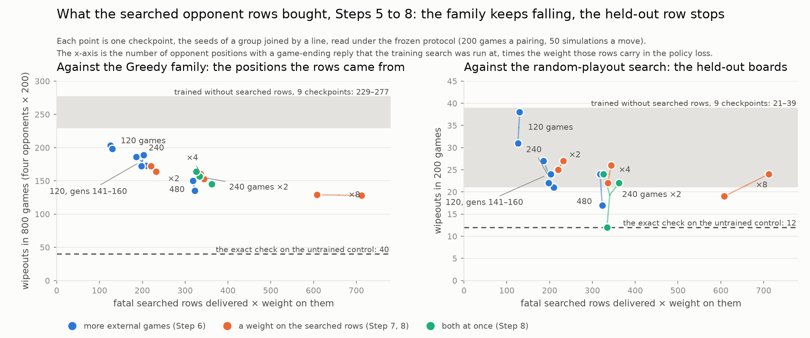
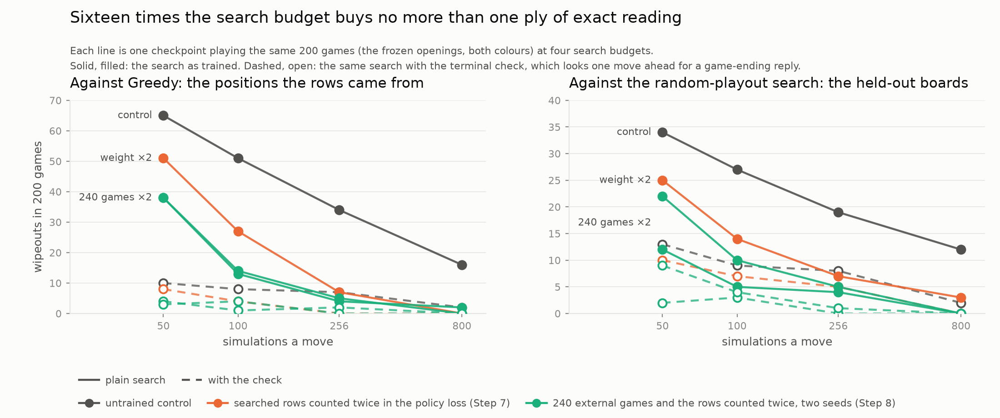

# Meeting with Dr. Boutell — the training route into the policy head, Steps 4 to 8

**November 9, 2026 · Lifei Liu · follow-up to the November 2 meeting**

**Purpose:** at the November 2 meeting the Step 3 series had ended in a located fault: a one-move tactic that the value head cannot learn and that one exact rule in the search ([Step 3c](../step3c-terminal-check.md)) removes without training. The week since has run five more experiments on the other half of the question, whether any *training* route reaches the tactic, and one of them does, through the policy head. This agenda sets out that chain, the one correction made to its wording after an audit, what the claim is now, and what the Phase 1 report should say, since writing starts this week. Two measurements the first reading of Step 8 asked for ran on the night before the meeting, a third seed of the combined group and the search-budget curve, and both are in (sections 1, 2 and 4).

Every number below is in the Step [4](../step4-results.md), [5](../step5-results.md), [6](../step6-results.md), [7](../step7-results.md) and [8](../step8-results.md) results pages and the pages they link, with the JSON behind each table under `research/results/`; each step's number in the table below links to its results page and each cell to the section the reading comes from. The [contribution page](../contribution.md) holds the claim as it stands.

| | | |
|---|---|---|
| 1 | The chain since November 2: Steps 4 to 8, in one table | ~15 min |
| 2 | What the claim is now, and one correction | ~10 min |
| 3 | The Phase 1 report: what it says and when | ~8 min |
| 4 | Figures: what exists and what to draw | ~5 min |
| 5 | What runs during the writing, and Phase 2 | ~4 min |
| 6 | Decisions | ~3 min |

---

## 1. The chain since November 2

All five steps start from the same checkpoint, the control recipe at generation 120, train twenty more generations, and are evaluated under the frozen protocol of [Step 1](../step1-pilot-results.md): 200 games per pairing, 50 simulations a move, fixed seed, every game recorded. Training self-play searches at 200 simulations; the evaluation deliberately searches at 50, where a reply the prior puts under 5% is often never visited, so the prior itself shows on the scorecard. Two seeds per group. The reading that matters most is the **held-out random-playout row** ([Step 3 results, section 4](../step3-results.md#4-the-random-playout-search-finds-the-same-hole-knowing-nothing)): an opponent with no learned or hand-written knowledge that finds the same one-move hole on different boards, so a change on that row is the network learning the tactic rather than memorising the positions of the opponents it trained against.

| step | what was changed | pre-registered expectation | what happened | wipeouts vs Greedy (control: 65) | held-out row (control: 34) |
|---|---|---|---|---|---|
| **[4](../step4-results.md)** | the exact rule from Step 3c switched on *inside* the training search, on top of the opponent mix ([design](../step4-design.md)) | the value head sees the resolved outcome and learns the low-disc positions ([predictions](../step4-results.md#3-the-predictions-one-by-one)) | null: the check stopped the wipeouts during training, so the lesson rows left the data ([training rows](../step4-results.md#5-the-training-rows)); the value head and the prior did not move ([probe](../step4-results.md#4-the-head-probe)); self-play 60% slower | [59, 58](../step4-results.md#2-the-scorecard) | 26, 29 |
| **[5](../step5-results.md)** | the network's search run at the *opponent's* positions in the external games, giving the policy head a target where the search reads ([design](../step5-design.md)) | the prior on the wiping reply rises, Greedy wipeouts fall ([predictions](../step5-results.md#3-the-predictions-one-by-one)) | the first training route that moved: prior 4% → 8% ([probe](../step5-results.md#4-the-head-probe)), the whole Greedy family down a third on both seeds, at no cost; the held-out row did not move ([what this establishes](../step5-results.md#7-what-this-establishes)) | [54, 45](../step5-results.md#2-the-scorecard) | 31, 38 |
| **[6](../step6-results.md)** | the dose doubled and quadrupled: 240 and 480 external games per generation ([design](../step6-design.md)) | the prior keeps rising; the held-out row is the test ([predictions](../step6-results.md#3-the-predictions-one-by-one)) | the held-out row moved, read pooled over checkpoints ([scorecard](../step6-results.md#2-the-scorecard)); prior to 12%; the dose is self-limiting, since each lesson teaches the network to stop producing the next ([what was run](../step6-results.md#1-what-was-run)); at 480 games the network's own play is a fifth of its data and it paid 11 to 20 points on strength and retention ([what this establishes](../step6-results.md#7-what-this-establishes)) | [55, 44 (240); 45, 33 (480)](../step6-results.md#2-the-scorecard) | 24, 22; 24, 17 |
| **[7](../step7-results.md)** | the Step 5 games unchanged, the searched rows counted 2 and 4 times in the policy loss ([design](../step7-design.md); the one code change of the series, `train.opponent_policy_weight`) | the readings follow the signal, not the games ([predictions](../step7-results.md#3-the-predictions-one-by-one)) | reproduced the Step 6 curve point for point, with nothing paid ([scorecard](../step7-results.md#2-the-scorecard)): the dose worked through the policy signal, the cost was the displaced self-play ([what this establishes](../step7-results.md#7-what-this-establishes)) | [51, 43 (×2); 41, 44 (×4)](../step7-results.md#2-the-scorecard) | 25, 27; 26, 22 |
| **[8](../step8-results.md)** | both axes at once (240 games, ×2), and the weight pushed to ×8 at the Step 5 games ([design](../step8-design.md)) | ×8: saturation on the held-out row expected; the combined group decides between "the signal stops" and "the distinct positions run out" ([predictions](../step8-results.md#3-the-predictions-one-by-one)) | ×8 read as expected, 19 and 24, with the Greedy family the lowest of any group and nothing paid at a 43% share of the policy loss; the combined group read 12 and 22 on its first two seeds and 24 on a third run overnight: the ×4 group's reading with one low seed, so twice the distinct positions at the same weighted count bought nothing ([what this establishes](../step8-results.md#7-what-this-establishes)) | [38, 38, 41 (240, ×2); 35, 34 (×8)](../step8-results.md#2-the-scorecard) | 12, 22, **24**; 19, 24 |

The quantity that lines the two axes up is the number of fatal searched rows times the weight on them, 130 to 700 across the series. The Greedy family keeps falling along it (about 200 per seed at the Step 5 dose, 170 to 180 at the first doubling by either route, 140 to 164 at the second, 129 at weight 8); the held-out row reads 17 to 27 at every point from 200 on, except one seed of fifteen, at 12. The search-budget curve (section 4, F6) says what that 17 to 27 is: the same checkpoints read 4 to 7 on the row at 256 simulations a move and 0 at 800.

## 2. What the claim is now, and one correction

**The claim** ([contribution page, section 1](../contribution.md#1-the-claim-in-one-sentence)). The value head cannot be taught a one-move tactic by any of four routes (opponent diversity, the value target at the position the search reads, the exact answer resolved inside the training search, and now the same data with a policy target beside it). The policy head can be, partly, by one route: a search run at the position the search reads. What it carries grows with the weight of that signal in its loss, whether the weight comes from more positions or from counting the same positions more times; it reaches the opponents that produce the positions first and the knowledge-free opponent's boards once the signal is doubled; the gain is concave; the positions limit themselves, because each lesson teaches the network to stop producing the next; and buying the signal with games costs the network's own strength while buying it with a weight in the loss costs nothing, up to a weight of 8; twice the distinct positions at the same weight buy nothing more, on three seeds. Where the knowledge-free opponent's row stops under the frozen protocol is where a 50-simulation search stops on these priors, since the same networks lose a quarter as many of those games at 256 simulations and none at 800. The exact check reaches every board at once and for nothing.

**The correction.** The Step 6 and 7 write-ups first read the held-out row as having moved "on every new checkpoint". An audit on November 8 found that the runs trained *without* any searched rows already spread from 21 to 39 wipeouts on that row (the continued control reads 26 and 38), so no single checkpoint of 200 games separates a dose group from the control. What holds is the pooled contrast: over the nine checkpoints trained without searched rows the row reads 15.9% of games lost with no discs; over the fourteen trained with them, from Step 6 on, 11.1%, a difference nearly five standard errors wide. The documents, the contribution page and the README now say so, in PR #76 ([Step 6 results, section 4](../step6-results.md#4-the-head-probe); [Step 7 results, section 7](../step7-results.md#7-what-this-establishes)). The claim's substance is unchanged; the per-checkpoint wording was wrong and is withdrawn. The same audit re-ran five old evaluation pairings at the current code and found them identical game for game ([evaluation recheck](../results/eval-recheck/README.md)), so the comparisons across steps are sound.

**Settled overnight: the combined group's 12.** It was the lowest plain-search reading on that row of the 26 checkpoints then evaluated, one seed, with a partner at 22, and under the 11% rate the series has read since Step 6 a 200-game checkpoint reads 12 or fewer about one time in a hundred. The third seed, run November 9 with the same config and seed 1339, reads 24 on that row and 164 on the Greedy family, the ×4 group's readings; the three seeds pool to 9.7% against the matched ×4 group's 12.0%, 1.1 standard errors ([Step 8 results, section 2](../step8-results.md#2-the-scorecard)). The 12 was the seed. The question Step 8 was designed to ask, whether the held-out row stops because the signal stops or because the distinct positions run out, is answered neither: the ×8 group rules out the first and the three combined seeds the second, and the search-budget curve (section 4, F6) says the row is a reading of the 50-simulation budget.

## 3. The Phase 1 report

Writing starts this week; the target is still a complete draft by the end of November. The outline in PR #63 planned three results sections for Steps 1 to 3. It now needs:

- **Results III, Steps 3 to 8 as one chain.** Three nulls into the value head (3, 3b, 4), the exact check (3c), and the policy route (5) with its dose curve (6), its mechanism (7) and its limits (8): one table in the shape of section 1 above, then one subsection per step with its scorecard rows and probe columns. Every table exists as Markdown already.
- **The discussion's claim** as written in section 2, with the tactical-versus-strategic horizon framing from the [contribution page, section 4](../contribution.md#4-tactical-and-strategic-weaknesses-and-the-horizon-between-them) and the Go cyclic attack placed on it.
- **Limits, stated plainly:** one game, one tactic, one starting checkpoint, two seeds per group and three in one, 200 games per row, one knowledge-free opponent, no adaptive adversary, and a repair that is standard practice whose contribution is where it was shown to be the only working one.
- **Figures:** section 4.

Proposed order: the results sections first, to the advisor as a partial draft around November 16, the rest by November 30. Markdown rendered to PDF unless LaTeX is wanted.

**To discuss:** whether a reader outside RL needs the probe tables at all, or only the scorecard rows and the two curves (F4 and F6); and whether Step 8, with the third seed and the budget curve, is presented as the end of the policy-route series, which is what the numbers say.

## 4. Figures: what exists and what to draw

Before this week the series had one figure, `research/figures/wipeout-values.png` (the value head's reading at the fatal positions, from Step 2). Every table since has been Markdown, which is right for the results pages and wrong for a reader who has to see a curve to believe it. The figures below are all drawable from JSON already under `research/results/`; none needs a new run. Proposed, in the order they appear in the report:

| # | figure | what it shows | data | status |
|---|---|---|---|---|
| F1 | the recording rule | how an opponent position becomes a training row, and which head gets a target at it, in Steps 3b, 5 and 7 | diagram, no data | to draw |
| F2 | wipeout move-number histogram | the wipeouts against Greedy end on moves 20 to 35, so this is a one-move trap in the midgame, not an endgame loss | `results/step2/`, `results/step3/` game records | to draw |
| F3 | scorecard dot plot | every checkpoint's reading on each row, with the 95% interval, one panel per row; makes "nothing else moved" visible | `results/step*/scorecard.json` | to draw |
| F4 | the chain | the Greedy-family sum and the held-out row against the weighted count of fatal rows, Steps 5 to 8, every seed of every group; the family keeps falling, the held-out row stops at 200 | `results/step{5,6,7,8}/searched-rows.json`, `scorecard.json` | **drawn**, below; `scripts/figures/chain.py` |
| F5 | the prior's tail | the share of the control's 63 fatal positions where the prior on the wiping reply is under 5%, by group; the tail closes from 65% to 8% | `results/step*/head-probe-fixed.json` | to draw |
| F6 | search-budget curves | wipeouts against Greedy and the random-playout search at 50, 100, 256 and 800 simulations, plain and checked, on the control and three trained checkpoints; sixteen times the budget buys no more than the one-ply check, and the trained prior lowers the budget that finds the reply | `results/step3c/dose-curve.json` ([Step 3c, section 7](../step3c-terminal-check.md#7-the-search-budget-curve)) | **drawn**, below; `scripts/figures/dose.py` |
| F7 | reliability curves | the value head's estimate against the outcome, by row group; the 8 to 9 points of overrating on the held-out opponents | `results/step*/value-calibration.json` | to draw |

F4 is the figure the report's argument rests on, and it is drawn:

The grey band is the nine checkpoints trained without searched rows; the dashed line is the exact check on the untrained control. Read left to right: the family falls at every step along the axis, through weight 8; the held-out row reaches the band's floor by a weighted count of 200 and stays there, from either route, except one of the combined group's three seeds, at 12, on the check's line.

F6 is drawn too, and it is the figure that says what F4's floor is:

Solid lines are the plain search, dashed the same search with the one-move check. On the untrained control, 800 simulations a move leave no fewer wipeouts than the check leaves at 50; on the checkpoints trained by the policy route, the plain search reaches the check's reading at about 256 simulations, because the prior they learned is what a modest budget needs to find the reply, and every line reaches zero at 800. F3 replaces four scorecard tables for a reader outside RL. The outline in PR #63 listed F1, F2, F3 and F7; F4, F5 and F6 are new with Steps 5 to 8, and F4 and F6 are drawn. One figure script per figure under `scripts/figures/`, matplotlib, each regenerable from the committed JSON.

**To discuss:** whether F4, F6 and F3 are enough for the partial draft, and whether the probe tables (section 4 of each results page) appear in the report at all or only as F5.

## 5. What runs during the writing, and Phase 2

Two items that needed no new code ran on the night before the meeting, so the writing starts with them in hand:

1. **The search-budget curve with and without the check**: 56 one-core jobs on the control, the weight-2 checkpoint and both combined-group checkpoints, 50, 100, 256 and 800 simulations, plain and checked, Greedy and held-out rows, on the frozen protocol's openings. It is [Step 3c, section 7](../step3c-terminal-check.md#7-the-search-budget-curve) and F6 (section 4), in PR #83.
2. **The third seed of the combined group**: 1.5 GPU-hours and the thirteen-row evaluation, read in section 2 and written into the Step 8 results and the contribution page in PR #82.

Nothing else is queued for the writing weeks; what remains needs a decision (section 6) or is Phase 2.

Phase 2, December to January, toward a workshop paper, in order of what most changes the claim:

1. **A second knowledge-free opponent**, so the transfer result rests on more than one row.
2. **A second tactic or a second game** with the same signature (a usually favourable state, one refuting reply, a lesson outnumbered in the data), 6×6 Othello first if the board size is cheap to parameterise.
3. **The lesson-to-look-alike ratio varied on purpose**, by weighting those rows in the value loss, to predict when the value head moves: the Step 3b count turned into a measurable quantity.
4. The population baseline: decide in December whether to run it or state in the limitations that it addresses strategic weaknesses and this one is tactical.

## 6. Decisions needed

1. Is the section 2 claim the right one for the report and for the paper's positioning? In particular, is "partly, by one route, and for nothing up to a weight of 8" the right strength?
2. Step 8 closes the policy-route series: the third seed and the budget curve answer the question it was designed to ask. Is anything else worth a GPU before the report, or does Phase 2 start from the second knowledge-free opponent?
3. Report: results sections first as a partial draft around November 16? Markdown to PDF?
4. Figures: F4 and F6 are drawn; F3 before the partial draft, the rest with the full draft?
5. The open pull requests, stacked in this order: #78 (Step 8 results), #81 (the chain figure, F4), #82 (the third seed) and #83 (the budget curve, F6); and #79 (this agenda), on its own. Steps 6 and 7, the Step 8 design and the held-out-row correction are merged.
