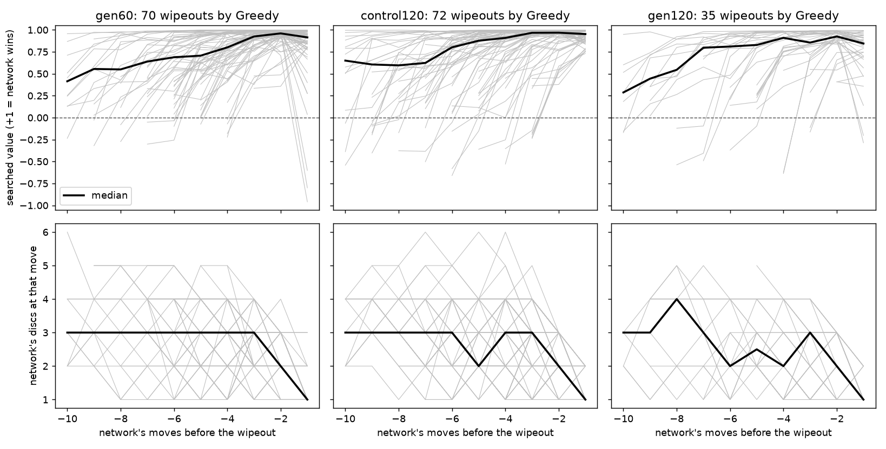

# Step 2 — Why the Network Loses to Greedy

**Applies to:** Step 2 of the [experiment design proposal](experiment-design-proposal-2026-10.md), following the [Step 1 pilot](step1-pilot-results.md)
**Date:** October 25, 2026
**Data:** the pilot's recorded games (`runs/research/pilot-2026-10-games/`, not committed), Run 1's self-play replay window (`runs/20260827-030939-full8x8-60cfdda-s1337/replay/`, not committed), and replays of the three Greedy pairings at 256 and 800 simulations per move (reports under [`results/step2/`](results/step2/))
**Scripts:** [`analyze_wipeouts.py`](../scripts/analyze_wipeouts.py), [`scan_replay_disc_counts.py`](../scripts/scan_replay_disc_counts.py)

**Gate B: a repeatable failure pattern with a supported mechanism.** The network is wiped out by Greedy because it rates a position where it holds one or two discs as a near-certain win, the search mostly agrees, and both are doing what the training data taught: in self-play, holding very few discs after the opening is rare and, when it happens, the side holding them usually wins. More search reduces the losses but does not change their character.

## 1. What the network believes while it is being wiped out

Every recorded network move carries the network's value estimate for the position before search (the *raw network value*) and after the tree search (the *searched value*), both from the network's point of view on a scale where +1 means "I win". The 177 wipeouts from the pilot, lined up by the network's distance from its last move:

| network | wipeouts | at its last move: discs held | searched value (median) | still positive | raw network value (median) |
|---|---:|---:|---:|---:|---:|
| gen60 | 70 | 1 | +0.91 | 96% | +0.99 |
| control120 | 72 | 1 | +0.95 | 100% | +0.99 |
| gen120 | 35 | 1 | +0.84 | 94% | +0.98 |

In 172 of 177 wipeouts the searched value was still positive at the network's last move, one ply before it had no discs left. In no game did it turn negative more than one move before the end. The raw network value is more confident than the searched one, so search is pulling the estimate in the right direction, just not far enough.

The lower panels show the shape of these games: for ten moves the network holds one to four discs, and the upper panels show its estimate climbing toward +1 as the count falls. The network is not blind to its disc count; it reads a low count as *good*.

**The won games look the same.** At the network's fifth move after the opening, the median searched value against Greedy is +0.91 in games it went on to win and +0.93 in games it was wiped out in. The network cannot tell the two situations apart, because to it they are the same situation: few own discs, many opponent discs, plenty of empty squares.

## 2. The losses were avoidable, and the search saw the escape

Replaying each wipeout with the rules module and searching exhaustively from the network's last few positions:

| network | wipeouts | a safe move existed at the last move | at the second-to-last | at the third-to-last |
|---|---:|---:|---:|---:|
| gen60 | 70 | 68 | 70 | 70 |
| control120 | 72 | 70 | 72 | 72 |
| gen120 | 35 | 31 | 35 | 33 of 33 |

"Safe" means a move after which no reply Greedy might choose (it plays any of its maximum-flip moves, breaking ties at random) leaves the network with zero discs. In 169 of 177 wipeouts such a move existed one ply before the end; one move earlier, in every one.

The search did not miss these moves. At the network's last move, the safe moves received a median 24% (gen60), 34% (control120) and 46% (gen120) of the search's visits, and in two thirds of the games a safe move was the second-most-visited move. The search compared the safe move with the fatal one and preferred the fatal one. For that to happen, the subtree under the fatal move must not have found Greedy's wiping reply, or found it too rarely to outweigh the network's +0.99 for everything else in that subtree. At 50 simulations spread over several candidate moves and their replies, a reply the policy head assigns a small prior may never be visited.

## 3. The training data said this was fine

Run 1's replay window, the positions the trainer was learning from over generations 31 to 60: 1,040,129 positions from about 18,000 self-play games. The first eight plies are excluded, because every game passes through tiny disc counts there by rule (after black's first move white holds exactly one disc).

| a side holds at most | positions from ply 8 on | per game | when that side was to move, it went on to win |
|---:|---:|---:|---:|
| 1 disc | 21 | 0.001 | 81% |
| 2 discs | 183 | 0.010 | 74% |
| 3 discs | 3,568 | 0.198 | 56% |
| 5 discs | 38,268 | 2.1 | 56% |

Two facts, and together they are the mechanism:

- **The position is almost absent from training.** A side holding one or two discs after the opening occurs about once per hundred self-play games. The pilot produced it in a third of the games against Greedy.
- **When it does occur, the side holding few discs usually wins.** 74% to 81% of the time. In self-play both players are the same network, and neither has any inclination to flip every disc it can, so a low disc count never gets punished. It correlates instead with what it correlates with in good Othello: few discs early means more mobility and fewer targets, and the side with few discs is often the side that is winning.

So the network learned a rule that is true about the games it was trained on and true in strong play: holding few discs in the opening is good. What it never saw is the boundary of that rule. Against an opponent that flips as many discs as it can, one disc is not a strong position, it is one move from the end, and nothing in a million training positions says so.

This is the self-play distribution-shift explanation the proposal raised as a hypothesis in Section 1, now with the numbers behind it. It is still a correlational account of the training data, not a controlled intervention; Step 3 is where an intervention would go.

## 4. More search helps, and does not change what goes wrong

The three Greedy pairings were replayed with the same openings, the same per-game seeds and therefore the same Greedy tie-breaks, changing only the network's simulations per move.

| simulations | gen60: score vs Greedy [95%], wipeouts | control120 | gen120 |
|---:|---|---|---|
| 50 (pilot) | 64.5% [57.7, 70.8], 70 | 64.0% [57.1, 70.3], 72 | 82.0% [76.1, 86.7], 35 |
| 256 | 76.5% [70.2, 81.8], 46 | 84.5% [78.8, 88.9], 31 | 93.0% [88.6, 95.8], 14 |
| 800 | 88.5% [83.3, 92.2], 23 | 95.5% [91.7, 97.6], 9 | 97.0% [93.6, 98.6], 6 |

The 256-simulation replays ran on the laptop (about 47 minutes per pairing); the 800-simulation replays ran on the CSSE cluster's CPU partition, one core per pairing, about two hours each.

Each step up in search budget removes a third to a half of the wipeouts that were left: 70, 46, 23 for gen60; 72, 31, 9 for control120; 35, 14, 6 for gen120. Sixteen times the pilot's budget still leaves gen60 losing more than one game in ten to Greedy. Every loss that remains, at either budget, is still a wipeout, still avoidable at the second-to-last move in every case, and, in all but two of the 29 games at 800 simulations where a safe last move existed, the search had visited a safe move. The searched value at gen60's last move stays above +0.9 at both budgets. gen120 at 800 simulations is the one place the search catches the loss: in four of its six wipeouts the searched value turned negative at the last move, but in none did it turn negative a move earlier, when every one of them was still avoidable. Search compensates for the value estimate in proportion to how much of the tree it can cover; it does not correct the estimate.

## 5. What this does and does not establish

Established, each by a different piece of evidence:

- The losses are early wipeouts and nothing else (Step 1, 3,000 games).
- The network's value estimate is near +1 in the positions it loses from, before and after search, and the won games get the same estimate (Section 1).
- An escape existed and was within the search's view in nearly every case (Section 2).
- Self-play produced such positions about once in a hundred games and labelled them as winning (Section 3).
- Raising the search budget reduces but does not remove the losses, and leaves their character unchanged (Section 4).

Not established:

- That changing the training distribution would fix it. Section 3 is a description of the data, not an intervention. The Step 1 result that the ownership head halves the wipeouts at the same generation is the closest thing to one, and it rests on a single training run per recipe; the ownership recipe's second seed (`e2-ownership-seed2`) would need to be fetched from the cluster to check it.
- Which of the two components matters more: the value head's +0.99 or the policy head's prior for the opponent's wiping reply. The recorded games hold root visit counts but not the prior over the opponent's replies, so separating them needs a targeted probe of a few dozen positions, which is cheap and is the natural next analysis.
- That the same thing happens against other disc-hungry opponents. The held-out roster for Step 3 should include one.

## 6. For the report

The one-paragraph version: an AlphaZero-style Othello agent trained only by self-play loses a third of its games to a one-ply greedy opponent, every one of them by being wiped out early, while beating a depth-4 minimax search 96% of the time. The agent values a position where it holds one disc at +0.99 because, in a million self-play positions, holding one or two discs after the opening happened about once per hundred games and the side holding them won three quarters of the time. The rule it learned is correct for the games it saw; the opponent it was never shown is the one that makes the rule fatal.
