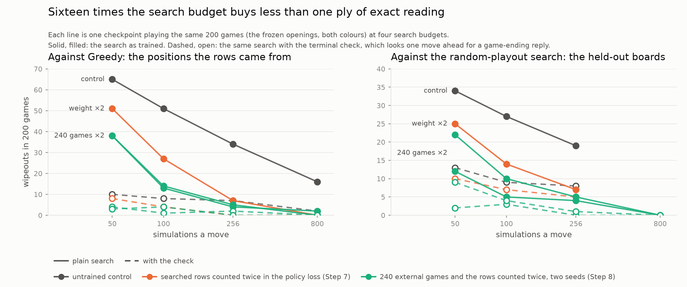

# Step 3c — The Terminal Check: the Weakness Is a Search-Depth Artefact

**Applies to:** the measurement named first in the [Step 3b results](step3b-results.md), section 8, item 1, and to the [Step 3 results](step3-results.md), section 10
**Code:** `SearchConfig.terminal_check`, the `;terminal_check` entrant option, and the `checked` variant of the head probe, on the `research/terminal-check` branch
**Evaluated:** November 1 and 2, 2026, on the cluster's CPU partition: nine pairings of 200 games, one job each, the same frozen protocol as Steps 1 to 3b, with the check switched on for one entrant and nothing else changed. No training was run. The search-budget curve of section 7 was evaluated November 9, 2026: 56 further pairings under the same protocol, on the control and three checkpoints trained in Steps 7 and 8.
**Reports:** [`results/step3c/scorecard.json`](results/step3c/scorecard.json) (the control at generation 120 with and without the check, every pairing's score, interval and wipeout count), [`results/step3c/head-probe.json`](results/step3c/head-probe.json) (the Step 3 probe with the fourth search variant, on the five Step 3b checkpoints), [`results/step3c/dose-curve.json`](results/step3c/dose-curve.json) (section 7: four checkpoints at four search budgets, with and without the check, against Greedy and the random-playout search). The arena reports and recorded games are under `~/reversi-runs/step3-eval/` on the cluster and are not committed.
**Verdict: the Step 2 weakness is a property of the search budget, not of the network's knowledge, and it is the same in every checkpoint trained so far.** The control network at generation 120, with no change to its weights, loses 65 games to Greedy by wipeout at 50 simulations. With one extra rule in the search, look one move ahead for a reply that ends the game before trusting the network's estimate of a position, it loses 12, and its score against Greedy goes from 67.5% to 94.0%. The same rule takes the Greedy family from 59 to 74% to 94 to 97%, and the held-out random-playout search, which the rule was never shown, from 81.0% to 93.2% with 34 wipeouts falling to 12. Against Edax and against its own earlier generation it changes nothing: the check closes one hole and adds no strength. On the Step 2 fatal positions it finds a surviving move 95 to 98% of the time on all five checkpoints at 50 simulations, where the plain search finds one 0% of the time. Section 5 reads the twelve games that remain.

## 1. What the check is

The search judges a move by the position after it, with the other side to move, and it judges that position by asking the network. In the wipeout, the position after the network's move is one where Greedy has a reply that takes every disc the network holds. The network rates that position as a near-certain win for itself (raw value −0.98 to −0.99 from Greedy's side, where the exact answer is +1), and gives the wiping reply a prior of 4%, so at 50 simulations the search never expands it and never sees that the game is over (Step 2 analysis, section 7; Step 3 results, section 5; Step 3b results, section 4). The information needed to avoid the loss is one move below the position the search already looks at.

The check reads it. When the search opens a position (attaches its legal moves and asks the network for a value), and the check is on, it first plays each legal move on the board and asks whether the game has ended. If one of them ends the game with a win for the side to move, the position is marked *proven*: its value is +1 for that side, the network's number for it is kept but not used, and the search treats it as finished, backing up the exact value and never descending below it again. If no move ends the game, nothing changes: the network's value is used, exactly as before. A game-ending move that only draws raises the position's value to at least 0, with the position left open.

Three design points matter for reading the results.

- **It costs no network calls.** Generating the legal moves and playing each one is bit-board work, a few microseconds a position. The evaluation jobs with the check on took the same wall time as the ones without, to within two minutes on jobs of fifteen to thirty.
- **It is exact where it fires and inert where it does not.** On a position with no game-ending move in reach, the search with the check on produces the same visits and the same values as the plain search (a unit test pins this). Every published number of the plain search stays valid; the check adds one column.
- **A proven position stays proven.** An earlier form of the rule only raised the value once, when the position was opened. Later simulations through the same position then backed up the network's cheerful numbers for the other replies, and the proven −1 for the move above it drifted back towards +0.8 within a few dozen simulations. Marking the node finished is what makes the rule hold against the prior that keeps sending the search back there.

The check is off by default and off in every self-play and evaluation configuration derived from the training config. It is switched on for an evaluation entrant with `;terminal_check` after the checkpoint path, and the arena report records it. Nothing in this step trains a network.

## 2. The scorecard

The control checkpoint at generation 120, evaluated twice against each opponent under the frozen protocol: the Step 3 evaluation without the check, and a new evaluation with it. Scores are the checkpoint's wins plus half its draws over 200 games, with 95% Wilson intervals; "wo" is the number of those games the checkpoint lost with no discs left. The rows not re-run are the ones where the control had at most four wipeouts to begin with (Edax L3, Minimax-d4, corner, Random): there the check has nothing to remove and the Edax L5 and L7 rows already measure its effect on strength.

| row | opponent | control120, plain search | control120, with the check | change |
|---|---|---|---|---|
| **held out** | Edax L7 | 10.0% [6.6, 14.9], 9 wo | 12.8% [8.8, 18.1], 3 wo | inside noise |
| **held out** | Edax L5 | 29.8% [23.8, 36.4], 0 wo | 26.2% [20.6, 32.8], 1 wo | inside noise |
| **held out** | rollout-r3000 | 81.0% [75.0, 85.8], 34 wo | 93.2% [88.9, 96.0], **12 wo** | +12.2 points, 22 fewer wipeouts |
| retention | gen60 | 62.5% [55.6, 68.9], 0 wo | 58.8% [51.8, 65.3], 0 wo | inside noise |
| seen | Greedy | 67.5% [60.7, 73.6], **65 wo** | 94.0% [89.8, 96.5], **12 wo** | +26.5 points, 53 fewer wipeouts |
| seen family | greedy-corner | 63.5% [56.6, 69.9], 72 wo | 94.0% [89.8, 96.5], 11 wo | +30.5 points |
| seen family | greedy-d2 | 59.0% [52.1, 65.6], 82 wo | 94.5% [90.4, 96.9], 10 wo | +35.5 points |
| seen family | noisy-greedy | 73.5% [67.0, 79.1], 52 wo | 96.5% [93.0, 98.3], 7 wo | +23.0 points |
| seen family | mobility | 91.5% [86.8, 94.6], 17 wo | 99.0% [96.4, 99.7], 2 wo | +7.5 points |

Two readings, and they are the two halves of the result.

**Against every disc-hungry opponent the losses are gone in proportion to how many were wipeouts.** The control lost 65 games to Greedy and all 65 were wipeouts; with the check it loses 12, all 12 wipeouts. The three Greedy variants and the mobility player read the same way: the wipeouts fall by five to eight times, and the score rises by the wipeouts removed. Nothing was trained; the network's estimate of the fatal position is as wrong as it was. The search no longer asks it.

**Against the opponents that do not wipe the network out, nothing moves.** Edax L5 and L7 and the generation-60 checkpoint are inside the intervals the Step 3 seeds span (the two control seeds of Step 3 differed by up to 10 points on one row). Edax's wipeouts fall from 9 to 3, which is the Step 3 finding that Edax wipeouts are a different loss, lost seven moves out and not avoidable at the last move (Step 3 results, section 7); the check can only remove the few that were. The check adds no playing strength. It removes one tactic's worth of losses and leaves the rest of the game as it was. The rollout row, the one held-out opponent that attacks the same weakness Greedy does, moves with the Greedy rows and is read in section 4.

## 3. The head probe

The Step 3 probe, extended with a fourth search variant and run on the five Step 3b checkpoints: every wipeout each suffered against Greedy in its own evaluation, at the network's last move, in the positions where a surviving move existed. Four searches are run from each position at 50 and 256 simulations and asked which move they choose: the real search as recorded; the value head alone (prior flattened); the policy head alone (value zeroed); and the real search with the check on. The table gives the share of positions in which the chosen move survives every reply Greedy might choose.

| network | positions | real @50 | **with the check @50** | value head only @50 | policy head only @50 | real @256 | **with the check @256** |
|---|---:|---:|---:|---:|---:|---:|---:|
| control120 | 63 | 0% | **95%** (60) | 98% | 5% | 56% | **97%** (61) |
| B-s1 | 52 | 0% | **96%** (50) | 100% | 12% | 62% | **98%** (51) |
| B-s2 | 63 | 0% | **98%** (62) | 100% | 8% | 59% | **100%** (63) |
| B-both-s1 | 60 | 0% | **97%** (58) | 100% | 7% | 62% | **98%** (59) |
| B-both-s2 | 66 | 0% | **98%** (65) | 100% | 9% | 59% | **98%** (65) |

The real search at 50 simulations replays the fatal move in every position, on every checkpoint, which is how the positions were selected. With the check on, the same search at the same budget finds a surviving move in 95 to 98% of them: as many as the value head alone finds with the prior removed, and more than the plain search finds with five times the budget. The five networks were trained under four different recipes (pure self-play, the Step 3 opponent mix, the mix with both sides recorded, two seeds of each) and they read the same to within the count of two or three positions. The weakness does not vary across them, and neither does the repair, because neither depends on the weights: the information is one move below a position the search already visits, and a search that looks there finds it.

The two or three positions per network that the check does not rescue have one surviving move each, with a prior of 7 to 21% on the move the network played and the single safe move further down the list. In two of the control's three the checked search moved away from the recorded fatal move and onto another fatal one. Section 5 finds the same shape in the games.

## 4. The random-playout row

The random-playout search is the held-out opponent the roster admitted for exactly this weakness: a tree search with 3,000 random playouts per move and no network, no table and no hand-written rule, which wipes out the self-play networks in a sixth of its games with the Step 2 signature (Step 3 results, section 4). It knows nothing about Greedy, and the check knows nothing about it.

| | control120, plain | control120, with the check |
|---|---:|---:|
| score | 81.0% [75.0, 85.8] | **93.2% [88.9, 96.0]** (186W 13L 1D) |
| wipeouts | 34 | **12** |
| searched value at the last move, median | +0.90 | −1.00 |
| games where it was still positive at the last move | 32 of 34 | 0 of 12 |
| avoidable at the last move (lower bound, see below) | 29 of 34 | 8 of 12 |
| avoidable at the second-to-last move | 34 of 34 | 11 of 12 |
| median share of search visits on safe moves, at the last move | 18% | 0% |
| games where no safe move was visited at all | 5 of 29 | 7 of 8 |

The check removes 65% of the wipeouts against an opponent it was never shown, and the score rises by the losses removed: 13 losses remain and 12 of them are wipeouts. This is the transfer that the Step 3 opponent mix was asked for and did not deliver (the Step 3 and 3b seeds sit at 80.5 to 88.0% on this row with 21 to 39 wipeouts). It transfers because it is not learned: the rule reads the board, and the board does not know who is playing.

The reduction is smaller than against Greedy (65% against 82 to 88%), and the residue says why. "Avoidable" here is a lower bound, because the random-playout opponent's reply to a move the network did not make cannot be enumerated, so a move counts as safe only if it survives every legal reply. Even so, 4 of the 12 remaining wipeouts were already lost at the network's last move and 1 of 12 two moves out, against 1 of 12 for Greedy: a 3,000-playout search sets deeper traps than a one-move flip counter does, and a one-move check does not see them. The other 7 are the first-play-urgency residue of section 5: the search knew every move it tried was lost and did not try the one that was not.

## 5. The twelve games that remain

[`scripts/analyze_wipeouts.py`](../scripts/analyze_wipeouts.py), run on the Greedy games with the check on, against the same reading of the plain control (Step 2 analysis, sections 2 to 4).

| | control120, plain | control120, with the check |
|---|---:|---:|
| wipeouts | 65 | 12 |
| searched value at the last move, median | +0.95 | **−1.00** |
| games where it was still positive at the last move | 64 of 65 | 0 of 12 |
| searched value one move earlier, median | +0.98 | +0.92 |
| avoidable at the last move | 63 of 65 | 11 of 12 |
| avoidable at the second-to-last move | 65 of 65 | 12 of 12 |
| median share of search visits on safe moves, at the last move | 40% | **0%** |
| games where no safe move was visited at all | 3 of 63 | **7 of 11** |
| games where a safe move was the runner-up | 51 of 63 | 2 of 11 |

The two columns describe two different failures.

**The plain search saw the escape and chose the trap.** Forty percent of its visits at the last move went to safe moves, and in 51 of 63 games a safe move was the runner-up. The value head told it the trap was better, and it believed the value head. This is the Step 2 finding.

**The checked search knew the trap was a trap and did not find the escape.** In all twelve games the searched value at the last move is exactly −1: the check saw the wiping reply, and the move was played anyway. In seven of the eleven games with a safe move, no safe move received a single visit. That is the first-play-urgency rule meeting a proven loss. An untried move starts out valued at the parent's mean minus a penalty (`fpu_reduction`, 0.25 times the square root of the prior already explored). Once every visited move at the root is proven lost, the parent's mean is −1, so every untried move starts *below* −1, and the exploration bonus of a 50-simulation search does not lift a move with a small prior above a visited move that is known to lose. The search keeps re-visiting moves it has already refuted. The move with the most visits is then a refuted one, and the best-move rule, most visits wins, plays it. In one game the position was already lost at the last move: the trap was set two moves earlier, where a one-move check cannot see it, and the value one move before the end (+0.92, positive in all twelve games) says the network did not see it either.

Both residues are fixable in the search, neither was run, and neither bears on the question this step asks. A search that excludes proven-lost moves from the final choice when an unrefuted move exists, or that extends the look-ahead to two plies at the root, would address the seven and the one. The 5% that remains after the check is the size of those two effects on a 50-simulation budget.

## 6. What this establishes

- **The Step 2 weakness is a search-depth artefact.** A one-move look-ahead that uses no learned knowledge removes 82 to 88% of the wipeouts against every disc-hungry opponent, on a network whose weights did not change. The value head's wrong belief about the fatal position is still there; the search stops reading it at the one place it is wrong, because the exact answer is one move further down and costs nothing to compute.
- **It is present in every checkpoint and independent of training.** Five networks from four recipes read the same on the probe, with and without the check. Steps 3 and 3b showed that twenty generations of opponent exposure and of value-only recording did not move the fatal estimate; this step shows that no estimate was needed. What the opponent mix was asked to teach, the search can read off the board.
- **The repair is local.** The check changes nothing against Edax or against the earlier generation. It is not a strength improvement; it is the removal of one class of loss. This separates the two things the Step 1 pilot conflated, overall strength and the Greedy anomaly: the anomaly can be removed on its own, and removing it leaves strength where it was.
- **Together with Steps 3 and 3b, this fixes where the fault sits.** The training data does not carry the lesson (Step 3b, section 5: about 80 rows against four thousand look-alikes labelled the other way); the value head cannot carry a one-move tactic as a smooth function of the position; the policy prior hides the reply; and the search budget is too small to look past the prior. The first three are properties of learning from game results; the fourth is the one a cheap, exact rule can override. The rule matters in Othello because a game can end from the middle of the board in one move: the wipeout rule puts a terminal position within one ply of ordinary-looking positions, where a learned evaluator is least likely to be asked and most likely to be wrong.

**What it does not establish.** It does not say the check should be on in self-play: training with it would change what the network learns about low-disc positions, and that is a training experiment, not a measurement. Section 7, run a week later, tests a larger search budget as the alternative and finds that sixteen times the budget buys less than the check does at 50 simulations. It does not test the two residual repairs in section 5. And the twelve games say the 95% is a property of this rule at this budget, not a ceiling.

## 7. The search-budget curve

Section 6 left one alternative untested: that the weakness is a matter of search depth in general, so that a larger budget without the check would remove it as well. Step 2's three points (50, 256 and 800 simulations: wipeouts falling by a third to a half per step and never to zero) could not separate that from the one-ply reading, and the Step 8 results, section 8, named the curve as the next measurement once the policy route had been followed to its end. This section runs it.

Four checkpoints, each playing the frozen protocol's 200 games against Greedy and against the random-playout search at 50, 100, 256 and 800 simulations a move, once with the plain search and once with the check: the untrained control at generation 120, and three checkpoints trained on the opponent's positions by the policy route, the Step 7 checkpoint with the searched rows counted twice in the policy loss and both seeds of the Step 8 combined group (240 external games, the rows counted twice). The entrant names are the frozen ones, so every budget draws the same openings as the frozen scorecard, and the 50-simulation plain cells are the scorecard's own reports, not re-run; the other 56 pairings ran November 9 on one core each. The columns of a row differ in the search budget and in nothing else. The table is `results/step3c/dose-curve.json` (`scripts/step3c_dose_curve.py`), the figure `scripts/figures/dose.py`.



Wipeouts in 200 games against Greedy:

| checkpoint | plain 50 | plain 100 | plain 256 | plain 800 | check 50 | check 100 | check 256 | check 800 |
|---|---:|---:|---:|---:|---:|---:|---:|---:|
| control120 (untrained) | 65 | 51 | 34 | 16 | 10 | 8 | 7 | 2 |
| Bw2-s1 (Step 7, rows counted twice) | 51 | 27 | 7 | 0 | 8 | 4 | 0 | 0 |
| B240w2-s1 (Step 8, 240 games, rows counted twice) | 38 | 13 | 4 | 2 | 4 | 1 | 2 | 0 |
| B240w2-s2 (the same, second seed) | 38 | 14 | 5 | 0 | 3 | 4 | 0 | 0 |

Against the random-playout search, the held-out opponent:

| checkpoint | plain 50 | plain 100 | plain 256 | plain 800 | check 50 | check 100 | check 256 | check 800 |
|---|---:|---:|---:|---:|---:|---:|---:|---:|
| control120 (untrained) | 34 | 27 | 19 | pending | 13 | 9 | 8 | pending |
| Bw2-s1 (Step 7, rows counted twice) | 25 | 14 | 7 | pending | 10 | 7 | 5 | pending |
| B240w2-s1 (Step 8, 240 games, rows counted twice) | 12 | 5 | 4 | 0 | 2 | 3 | 0 | 0 |
| B240w2-s2 (the same, second seed) | 22 | 10 | 5 | 0 | 9 | 4 | 1 | 0 |

The two 800-simulation pairings of the control and of Bw2-s1 against the random-playout search, about nine hours each on one core, had not reported when this section was written and are marked pending; the JSON and the figure are regenerated from the reports when they land.

The scores move with the wipeouts throughout and are in the JSON; against Greedy the control reads 67.5% at 50 simulations, 92.0% at 800 and 95.0% at 50 with the check. Four readings.

**Sixteen times the budget buys less than one ply of exact reading.** On the untrained control the plain search at 800 simulations leaves 16 wipeouts against Greedy, and the check at 50 leaves 10; against the random-playout search the plain search at 256 leaves 19 where the check at 50 leaves 13. The curve on the control is slow because of what section 1 and the Step 2 analysis found: the prior on the wiping reply is 3.6% at the median of these positions, and a search that gives a child that share of its visits needs some hundreds of simulations at the position above before the child is opened even once. Each step of the budget removes about a quarter to a half of the remaining wipeouts, 65, 51, 34, 16, and the one-ply rule removes five sixths of them at the smallest budget. The Step 2 reading stands as a curve: the search was short of one specific ply, not of depth.

**What the check leaves is not a budget problem until 800.** The checked curve on the control is nearly flat, 10, 8, 7, 2 against Greedy and 13, 9, 8 against the random-playout search. Section 5 read the residue as the first-play-urgency rule meeting a proven loss: every move the search tried was known to lose and the one that did not was never tried. More simulations do eventually try it, which is why 2 remain at 800 and not 7, but 256 do not; the residue is a property of how the search orders untried moves, which section 5 names two cheap fixes for, and the budget is the expensive way to buy the same thing.

**The trained prior does not remove the hole at 50 simulations; it lowers the budget at which the plain search finds the reply itself.** From 50 to 100 simulations the control's wipeouts fall by a fifth, 65 to 51 against Greedy and 34 to 27 against the random-playout search; the trained checkpoints' fall by half or more, 51 to 27, 38 to 13 and 38 to 14 against Greedy, 25 to 14, 12 to 5 and 22 to 10 against the random-playout search. At 256 simulations the plain search on the trained checkpoints reads 4 to 7 against Greedy and 4 to 7 against the random-playout search, which is where the check sits at 50 simulations on the same checkpoints (3 to 8, and 2 to 10) and where the control's plain search has not arrived at 800. The mechanism is the one the Step 5 results named: the policy route raised the prior on the wiping reply from 4% to 8 to 12%, and a child carrying 12% of the prior is opened at a budget where one carrying 4% is not. The training signal and the search budget multiply. What twenty generations of the policy route bought, read on this axis, is a move of the budget that finds the reply from past 800 simulations to about 256.

**The held-out row reads as the Greedy row does at every budget, so the reading every trained group stops at under the frozen protocol is a reading of the budget.** The Step 6 to 8 groups all read 17 to 27 wipeouts against the random-playout search at 50 simulations, whichever way the policy signal was bought, and the Step 8 design asked whether that was where the signal stopped or where the distinct positions ran out. At 256 simulations the two combined-group checkpoints read 4 and 5 on that row with the plain search, and at 800 both read 0, with or without the check. The row stops where a 50-simulation search stops on these priors, not where the networks stop. With the check on, every trained checkpoint reads 0 to 2 against Greedy and 0 to 5 against the random-playout search from 256 simulations on, and 0 on both rows at 800 where it has reported.

**What it costs.** The check costs nothing in wall time at any budget (section 1). The budget is paid for in proportion: on one core the Greedy pairings took 15 to 22 minutes at 50 simulations and two and a half to three hours at 800, and the random-playout pairings, whose opponent spends 3,000 playouts a move, six hours at 50 and about nine at 800. A search at 800 simulations in play is sixteen times the compute of one at 50, for a reading the one-ply rule gives at 50.

**What it does not establish.** One seed of the weight-2 recipe and two of the combined one, 200 games a cell, so neighbouring cells that differ by a few wipeouts are not individually resolved and the curve is read as a whole; no budget between 256 and 800; the random-playout opponent at one strength, 3,000 playouts a move; and nothing about what a budget above 50 would do inside training, which is a training experiment and not a measurement.

## 8. Reproduction

On the cluster, from the `research/terminal-check` branch, with the Step 3 checkpoints and recorded games under `~/reversi-runs/`:

```bash
# one job per pairing, the frozen protocol, the check on for one entrant
ckpt=~/reversi-runs/control/checkpoints/gen_00120.pt
for opp in greedy greedy-corner greedy-d2 noisy-greedy mobility rollout-r3000 edax-l5 edax-l7 \
           "gen60=$HOME/reversi-models/reversi-8x8-gen60.pt"; do
  sbatch --job-name="rz-eval-control120-tc-${opp%%=*}" --cpus-per-task=1 --mem=6G slurm/cpu.sbatch \
    uv run --offline reversi arena --suite custom \
      -e "control120-tc=$ckpt@50;terminal_check" -e "$opp" \
      --games 200 --simulations 50 --workers 1 --seed 20261025 --record-games \
      --out ~/reversi-runs/step3-eval/control120-tc-vs-${opp%%=*}.json
done

# the scorecard, with CHECKPOINTS set to ("control120", "control120-tc")
python scripts/step3_scorecard.py ~/reversi-runs/step3-eval --markdown --out research/results/step3c/scorecard.json

# the probe, on the Step 3b checkpoint map; the `checked` variant is always included
python scripts/probe_heads.py ~/reversi-runs/step3-eval --protocol ~/reversi-runs/step3-eval/step3b-checkpoints.json \
    --out research/results/step3c/head-probe.json

# the residual wipeouts
python scripts/analyze_wipeouts.py ~/reversi-runs/step3-eval/control120-tc-vs-greedy-games --opponent greedy
python scripts/analyze_wipeouts.py ~/reversi-runs/step3-eval/control120-tc-vs-rollout-r3000-games --opponent rollout-r3000 --replies any
```

The search-budget curve (section 7), with the Step 7 and 8 checkpoints under `~/reversi-runs/`: one job per pairing, the frozen entrant name so the openings are the scorecard's, the budget and the check on the entrant, the plain 50-simulation cell taken from the scorecard.

```bash
declare -A ckpt=(
    [control120]=~/reversi-runs/control/checkpoints/gen_00120.pt
    [Bw2-s1]=~/reversi-runs/step7-Bsp-w2-s1/checkpoints/gen_00140.pt
    [B240w2-s1]=~/reversi-runs/step8-Bsp240-w2-s1/checkpoints/gen_00140.pt
    [B240w2-s2]=~/reversi-runs/step8-Bsp240-w2-s2/checkpoints/gen_00140.pt
)
for c in "${!ckpt[@]}"; do for o in greedy rollout-r3000; do for s in 50 100 256 800; do
  for mode in plain tc; do
    [ "$mode" = plain ] && [ "$s" = 50 ] && continue
    spec="$c=${ckpt[$c]}@$s"; tag="s$s"
    [ "$mode" = tc ] && { spec="$spec;terminal_check"; tag="$tag-tc"; }
    sbatch --job-name="rz-dose-$c-$tag-$o" --cpus-per-task=1 --mem=6G slurm/cpu.sbatch \
      uv run reversi arena --suite custom -e "$spec" -e "$o" \
        --games 200 --simulations 50 --workers 1 --seed 20261025 --record-games \
        --out ~/reversi-runs/dose-eval/$c-$tag-vs-$o.json
  done
done; done; done

python scripts/step3c_dose_curve.py ~/reversi-runs/dose-eval \
    --plain-50-from research/results/step8/scorecard.json \
    --out research/results/step3c/dose-curve.json --markdown
python scripts/figures/dose.py --out research/figures/dose-curve.png
```

The unit tests for the check are in `tests/unit/test_terminal_check.py`: the exact value where a game-ending move exists, the proven node staying proven, identical results where no move ends the game, the default being off everywhere, and the entrant option. `tests/unit/test_game_batch.py` checks that the batched self-play scheduler applies it the same way as the one-at-a-time search.
