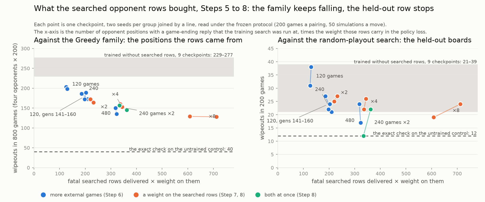

# Step 8 — Results: The Two Axes Combined, and the Weight Pushed Past Them

**Applies to:** the [Step 8 design](step8-design.md); every number below is read against the predictions in its section 4
**Runs:** `step8-Bsp240-w2-s1`, `-s2` (`configs/full8x8_step8_search240_weight2.yaml`: 240 external games, the searched rows counted twice) and `step8-Bsp-w8-s1`, `-s2` (`configs/full8x8_step8_weight8.yaml`: the Step 5 games, the rows counted eight times), twenty generations from `control120`; compared with the Step 5, 6 and 7 seeds, not re-run
**Date:** November 9, 2026
**Data:** `research/results/step8/` (scorecard, fixed-position head probe, searched-row counts, row counts, per-generation training metrics, calibration)

**Verdict: the weight pushed to 8 read where the design expected, and the two axes combined read where no group had read before on one seed and where the weight-4 group reads on the other.** The weight-8 group, with the Step 5 games and a weighted count of fatal rows near 650, twice the weight-4 group's, wipes out against the random-playout search 19 and 24 times, 43 in 400 games, inside the band the design named as saturation; its Greedy family sum reads 129 and 128, the lowest of any group, and at a policy-loss share of 43% it paid nothing on the retention or Edax rows. The combined group, 240 external games with the rows counted twice, reads 12 and 22 on the random-playout row: the 12 is the lowest plain-search reading of the 26 checkpoints evaluated on that row, under the 17 of the best 480-game seed, and the 22 is the weight-4 and 240-game groups' reading. Pooled, 34 in 400 games, 8.5%, the lowest of any group and 1.6 standard errors under the weight-4 group's 48, which is matched to it on the weighted count. That is neither of the outcomes the design wrote for this group. On the Greedy family and the prior's tail the combined group reads like the weight-4 group, 157 and 145 against 153 and 160, and 11% against 11% and 6%: twice the distinct positions at the same weighted count bought nothing there. What the series now says is that the weighted signal is not what stops the held-out row, since twice as much of it at weight 8 bought the family and nothing on the row; whether more distinct positions do is left to one seed of 200 games, which cannot decide it.



*The series on one axis. Left: wipeouts summed over the four disc-hungry opponents, the positions the searched rows came from; right: wipeouts against the random-playout search, the held-out boards. The grey band is the nine checkpoints trained without searched rows, the dashed line the exact one-move check on the untrained control. The family keeps falling along the axis to weight 8; the held-out row reads 17 to 27 from a weighted count of 200 on, except the combined group's one seed at 12. Drawn by `scripts/figures/chain.py` from the JSON under `research/results/`.*

## 1. What was run

Four checkpoints. The combined group's games are the Step 6 240-game group's and its loss is the Step 7 weight-2 group's; the weight-8 group's games are Step 5's and its loss counts every searched opponent row eight times. The Step 5, 6 and 7 runs are the earlier points and were not re-run.

| run | seed | weight | self-play + external games per generation | training rows in the twenty generations | of which searched opponent rows | fatal rows | fatal rows x weight | wall time | network's score in the external games | wiped out in the external games |
|---|---|---:|---:|---:|---:|---:|---:|---:|---:|---:|
| B-both-sp-s1 (Step 5) | 1337 | 1 | 480 + 120 | 685,099 | 58,586 | 126 | 126 |  | 94.2% | 5.3% |
| B-both-sp-s2 (Step 5) | 1338 | 1 | 480 + 120 | 684,688 | 58,341 | 130 | 130 |  | 94.1% | 5.4% |
| Bsp240-s1 (Step 6) | 1337 | 1 | 360 + 240 | 677,199 | 118,000 | 203 | 203 |  | 95.3% | 4.2% |
| Bsp240-s2 (Step 6) | 1338 | 1 | 360 + 240 | 677,644 | 118,273 | 198 | 198 |  | 95.5% | 4.1% |
| Bsp480-s1 (Step 6) | 1337 | 1 | 120 + 480 | 664,015 | 239,039 | 318 | 318 |  | 95.9% | 3.3% |
| Bsp480-s2 (Step 6) | 1338 | 1 | 120 + 480 | 664,062 | 239,185 | 323 | 323 |  | 96.1% | 3.4% |
| Bw2-s1 (Step 7) | 1337 | 2 | 480 + 120 | 685,379 | 58,760 | 110 | 220 |  | 95.1% | 4.6% |
| Bw2-s2 (Step 7) | 1338 | 2 | 480 + 120 | 685,446 | 58,691 | 116 | 232 |  | 94.8% | 4.8% |
| Bw4-s1 (Step 7) | 1337 | 4 | 480 + 120 | 686,329 | 59,096 | 86 | 344 |  | 96.0% | 3.6% |
| Bw4-s2 (Step 7) | 1338 | 4 | 480 + 120 | 686,638 | 58,875 | 84 | 336 |  | 96.3% | 3.5% |
| **B240w2-s1** | 1337 | 2 | 360 + 240 | 678,798 | 118,504 | 167 | 334 | 1.63 h | 96.1% | 3.5% |
| **B240w2-s2** | 1338 | 2 | 360 + 240 | 678,110 | 118,519 | 181 | 362 | 1.66 h | 96.0% | 3.8% |
| **Bw8-s1** | 1337 | 8 | 480 + 120 | 686,606 | 59,019 | 76 | 608 | 1.62 h | 96.4% | 3.2% |
| **Bw8-s2** | 1338 | 8 | 480 + 120 | 686,592 | 58,856 | 89 | 712 | 1.59 h | 96.1% | 3.7% |

The combined group's rows match the 240 group's to within 0.3% and the weight-8 group's match Step 5's to within 0.3%. The value loss at generation 140 reads 0.465 and 0.451 in the combined group, where the 240 group read 0.468 and 0.469, and 0.571 and 0.564 at weight 8, where Step 5 read 0.570 and 0.553: on each route the value head was trained on the same rows with the same targets and reached the same place. The four jobs ran on the cluster's L40S node with 22 self-play workers; the first generation of each ran at 279 to 294 seconds and the last at 216 to 227, the Step 7 rate, so the mean of 230 to 238 reflects the node at the start of the jobs and not the recipe, which is Step 5's and Step 6's at play time, with the weight applied in the trainer.

**Prediction 1 held in substance, with the weight-8 group above its written range on one seed.** The searched-row count (`scripts/step5_searched_rows.py`, `research/results/step8/searched-rows.json`) finds the opponent-to-move rows at which some legal move takes every disc of the network's, and reads the stored policy target there:

| run | searched opponent rows | of which at a fatal position | target mostly on a wiping move | mean target mass on wiping moves |
|---|---:|---:|---:|---:|
| step5-Bboth-sp-s1 (Step 5) | 58,586 | 126 | 105 (83%) | 0.74 |
| step5-Bboth-sp-s2 (Step 5) | 58,341 | 130 | 112 (86%) | 0.74 |
| step6-Bsp240-s1 (Step 6) | 118,000 | 203 | 180 (89%) | 0.78 |
| step6-Bsp240-s2 (Step 6) | 118,273 | 198 | 170 (86%) | 0.75 |
| step6-Bsp480-s1 (Step 6) | 239,039 | 318 | 269 (85%) | 0.76 |
| step6-Bsp480-s2 (Step 6) | 239,185 | 323 | 289 (89%) | 0.79 |
| step7-Bsp-w2-s1 (Step 7) | 58,760 | 110 | 99 (90%) | 0.79 |
| step7-Bsp-w2-s2 (Step 7) | 58,691 | 116 | 97 (84%) | 0.73 |
| step7-Bsp-w4-s1 (Step 7) | 59,096 | 86 | 79 (92%) | 0.82 |
| step7-Bsp-w4-s2 (Step 7) | 58,875 | 84 | 71 (85%) | 0.76 |
| **step8-Bsp240-w2-s1** | 118,504 | 167 | 158 (95%) | 0.81 |
| **step8-Bsp240-w2-s2** | 118,519 | 181 | 154 (85%) | 0.74 |
| **step8-Bsp-w8-s1** | 59,019 | 76 | 69 (91%) | 0.81 |
| **step8-Bsp-w8-s2** | 58,856 | 89 | 74 (83%) | 0.78 |

The target is on the wiping reply in five rows of six and more, 83 to 95%. The combined runs delivered 167 and 181 fatal rows, inside the design's 140 to 190, for a weighted count of 334 and 362, near the 350 the design wrote. The weight-8 runs delivered 76 and 89, the second above the 55 to 80 written, for 608 and 712, the second above the 440 to 650 written: the weight limits its own rows, as the weight of 4 did, but not faster. The per-generation series (`research/results/step8/training.json`) reads as in Steps 6 and 7. The combined runs produced 73 and 73 fatal rows in their first five generations and 25 and 27 in their last five, where the 240 group produced 74 and 72, then 44 and 34; the weight-8 runs 41 and 36, then 7 and 12, where the weight-4 runs produced 42 and 41, then 8 and 7. The wipeout rate in the external games ends at 2.2% on both combined seeds and 1.5% and 2.0% at weight 8; the design wrote "below 2%" for both groups and "faster than any earlier group", and the weight-4 runs ended at 1.3% and 1.2%. The weight of 8 taught the avoidance no faster than the weight of 4, and the weight of 2 on twice the games no faster than the weight of 2 on the Step 5 games (2.0% and 2.5%). The games themselves are the 240 group's and Step 5's in every other respect, the score in them 96% as in Step 7.

The axis the series is read on is the fatal rows delivered times the weight on them, how many times a fatal row is counted in the policy loss over the run: 126 and 130 in Step 5; 203 and 198 at 240 games; 220 and 232 at weight 2; 318 and 323 at 480 games; 344 and 336 at weight 4; 334 and 362 in the combined group; 608 and 712 at weight 8. The combined group sits beside the weight-4 and 480 groups on it with twice the weight-4 group's distinct positions; the weight-8 group sits past every earlier point.

## 2. The scorecard

Scores are the checkpoint's wins plus half its draws over 200 games, with 95% Wilson intervals; "wo" is the number of those games the checkpoint lost with no discs left. Every column is the plain search at 50 simulations. The Step 6 and 7 columns are those steps' numbers, not re-run; the control, Step 5 and weight-2 columns are in the [Step 7 results](step7-results.md), section 2, and all fifteen columns are in `research/results/step8/scorecard.md`.

| row | opponent | Bsp240-s1 (Step 6) | Bsp240-s2 (Step 6) | Bsp480-s1 (Step 6) | Bsp480-s2 (Step 6) | Bw4-s1 (Step 7) | Bw4-s2 (Step 7) | B240w2-s1 | B240w2-s2 | Bw8-s1 | Bw8-s2 |
| --- | --- | --- | --- | --- | --- | --- | --- | --- | --- | --- | --- |
| **held out** | Edax L7 | 5.2% [2.9, 9.3], 5 wo | 13.0% [9.0, 18.4], 5 wo | 4.5% [2.4, 8.3], 9 wo | 6.2% [3.7, 10.5], 11 wo | 12.0% [8.2, 17.2], 8 wo | 12.8% [8.8, 18.1], 7 wo | 8.8% [5.6, 13.5], 5 wo | 8.2% [5.2, 12.9], 5 wo | 9.2% [6.0, 14.1], 8 wo | 15.5% [11.1, 21.2], 5 wo |
| **held out** | Edax L5 | 28.5% [22.7, 35.1], 4 wo | 23.8% [18.4, 30.1], 2 wo | 17.2% [12.6, 23.1], 3 wo | 21.5% [16.4, 27.7], 2 wo | 33.5% [27.3, 40.3], 2 wo | 33.0% [26.9, 39.8], 3 wo | 31.0% [25.0, 37.7], 0 wo | 36.8% [30.4, 43.6], 2 wo | 37.2% [30.8, 44.1], 1 wo | 35.2% [29.0, 42.1], 1 wo |
| **held out** | Edax L3 | 65.5% [58.7, 71.7], 1 wo | 69.5% [62.8, 75.5], 1 wo | 53.5% [46.6, 60.3], 0 wo | 56.2% [49.3, 62.9], 2 wo | 73.0% [66.5, 78.7], 0 wo | 68.0% [61.2, 74.1], 0 wo | 67.0% [60.2, 73.1], 3 wo | 66.8% [60.0, 72.9], 1 wo | 70.0% [63.3, 75.9], 2 wo | 69.2% [62.5, 75.2], 2 wo |
| **held out** | rollout-r3000 | 87.5% [82.2, 91.4], **24 wo** | 88.2% [83.1, 92.0], **22 wo** | 87.5% [82.2, 91.4], **24 wo** | 90.0% [85.1, 93.4], **17 wo** | 87.0% [81.6, 91.0], **26 wo** | 87.8% [82.5, 91.6], **22 wo** | 93.0% [88.6, 95.8], **12 wo** | 88.8% [83.6, 92.4], **22 wo** | 89.0% [83.9, 92.6], **19 wo** | 88.0% [82.8, 91.8], **24 wo** |
| retention | gen60 | 63.2% [56.4, 69.6], 0 wo | 61.8% [54.9, 68.2], 0 wo | 44.8% [38.0, 51.7], 0 wo | 44.8% [38.0, 51.7], 0 wo | 59.2% [52.3, 65.8], 0 wo | 58.0% [51.1, 64.6], 0 wo | 59.0% [52.1, 65.6], 0 wo | 56.2% [49.3, 62.9], 0 wo | 59.5% [52.6, 66.1], 0 wo | 70.2% [63.6, 76.2], 0 wo |
| seen | Greedy | 72.5% [65.9, 78.2], **55 wo** | 78.0% [71.8, 83.2], **44 wo** | 77.5% [71.2, 82.7], **45 wo** | 83.5% [77.7, 88.0], **33 wo** | 79.5% [73.4, 84.5], **41 wo** | 78.0% [71.8, 83.2], **44 wo** | 81.0% [75.0, 85.8], **38 wo** | 81.0% [75.0, 85.8], **38 wo** | 82.5% [76.6, 87.1], **35 wo** | 83.0% [77.2, 87.6], **34 wo** |
| seen | Minimax-d4 | 98.5% [95.7, 99.5], 0 wo | 94.8% [90.7, 97.1], 0 wo | 94.2% [90.1, 96.7], 1 wo | 95.8% [92.0, 97.8], 0 wo | 97.2% [93.9, 98.8], 0 wo | 97.0% [93.6, 98.6], 0 wo | 95.5% [91.7, 97.6], 1 wo | 97.8% [94.6, 99.1], 0 wo | 97.0% [93.6, 98.6], 0 wo | 96.5% [93.0, 98.3], 1 wo |
| seen family | greedy-corner | 75.0% [68.6, 80.5], 50 wo | 74.5% [68.0, 80.0], 51 wo | 82.5% [76.6, 87.1], 35 wo | 87.5% [82.2, 91.4], 25 wo | 78.5% [72.3, 83.6], 43 wo | 78.2% [72.0, 83.4], 43 wo | 78.5% [72.3, 83.6], **43 wo** | 78.0% [71.8, 83.2], **44 wo** | 83.5% [77.7, 88.0], **33 wo** | 82.5% [76.6, 87.1], **35 wo** |
| seen family | greedy-d2 | 76.5% [70.2, 81.8], 47 wo | 75.0% [68.6, 80.5], 50 wo | 79.0% [72.8, 84.1], 42 wo | 75.0% [68.6, 80.5], 50 wo | 78.5% [72.3, 83.6], 43 wo | 75.5% [69.1, 80.9], 49 wo | 76.0% [69.6, 81.4], **47 wo** | 82.5% [76.6, 87.1], **35 wo** | 82.0% [76.1, 86.7], **36 wo** | 81.5% [75.5, 86.3], **37 wo** |
| seen family | noisy-greedy | 81.0% [75.0, 85.8], 37 wo | 86.5% [81.1, 90.6], 27 wo | 86.0% [80.5, 90.1], 28 wo | 86.5% [81.1, 90.6], 27 wo | 87.0% [81.6, 91.0], 26 wo | 88.0% [82.8, 91.8], 24 wo | 85.5% [80.0, 89.7], **29 wo** | 85.0% [79.4, 89.3], **28 wo** | 87.5% [82.2, 91.4], **25 wo** | 89.0% [83.9, 92.6], **22 wo** |
| seen family | corner | 98.0% [95.0, 99.2], 4 wo | 99.5% [97.2, 99.9], 1 wo | 98.5% [95.7, 99.5], 3 wo | 98.5% [95.7, 99.5], 3 wo | 97.5% [94.3, 98.9], 5 wo | 98.5% [95.7, 99.5], 3 wo | 98.0% [95.0, 99.2], 2 wo | 99.5% [97.2, 99.9], 1 wo | 98.0% [95.0, 99.2], 4 wo | 98.5% [95.7, 99.5], 3 wo |
| seen family | mobility | 95.5% [91.7, 97.6], 9 wo | 96.0% [92.3, 98.0], 8 wo | 97.5% [94.3, 98.9], 5 wo | 96.5% [93.0, 98.3], 6 wo | 93.5% [89.2, 96.2], 13 wo | 97.0% [93.6, 98.6], 6 wo | 92.0% [87.4, 95.0], 16 wo | 96.5% [93.0, 98.3], 7 wo | 95.5% [91.7, 97.6], 9 wo | 95.0% [91.0, 97.3], 10 wo |
| sanity | Random | 99.5% [97.2, 99.9], 1 wo | 100% [98.1, 100], 0 wo | 99.0% [96.4, 99.7], 2 wo | 100% [98.1, 100], 0 wo | 100% [98.1, 100], 0 wo | 100% [98.1, 100], 0 wo | 100% [98.1, 100], 0 wo | 99.5% [97.2, 99.9], 1 wo | 100% [98.1, 100], 0 wo | 99.5% [97.2, 99.9], 1 wo |

**The held-out row: the weight-8 group where the design expected, the combined group split across its two seeds.** The random-playout search, the opponent that finds the same hole with no knowledge of Greedy and on different boards, wipes out the weight-8 networks 19 and 24 times and the combined networks 12 and 22 times. The checkpoints trained without searched rows spread from 21 to 39 on this row and the Step 6 and 7 checkpoints from 17 to 27 ([Step 6 results](step6-results.md), section 4), so the row is read pooled. The weight-8 pair loses 43 of 400 games with no discs, 10.8%, beside the 240 group's 46, the 480 group's 41, the weight-2 group's 52 and the weight-4 group's 48: the same reading at twice the weighted count of any of them. The combined pair loses 34 of 400, 8.5%. Against the weight-4 group, matched on the weighted count, that is 14 fewer in 400 with a standard error near 8.5, 1.6 standard errors; against the five groups from a weighted count of 200 on, pooled, 230 of 2,000, 11.5%, it is 3 points with a standard error near 1.7. The 12 on seed 1 is the lowest reading on this row of the 26 checkpoints evaluated with the plain search; the next lowest are 17 (the 480 group's second seed) and 19 (the Step 3 group D, which paid half its strength for it, and the weight-8 group's first seed). Under the 11% rate the series has read since Step 6, a checkpoint of 200 games reads 12 or fewer about one time in a hundred, and fourteen such checkpoints have been read, so one such reading somewhere in the series had about one chance in seven. The 22 on seed 2 is the weight-4 group's second seed and the 240 group's second seed. Pooled over all four new checkpoints the row reads 77 of 800, 9.6%, against 286 of 1,800, 15.9%, over the nine checkpoints trained without searched rows, the pooled move of Steps 6 and 7 again, 4.3 standard errors wide. The scores move with the wipeouts: 93.0% on the combined group's first seed, the highest on this row in the series, 88.0 to 89.0% on the other three.

**The Greedy family fell at weight 8 to the lowest of any group, and in the combined group to where the weight-4 group sits.** Summed over the four disc-hungry opponents, the wipeouts per seed read 129 and 128 at weight 8, against the weight-4 group's 153 and 160 and the 480 group's 150 and 135, and 157 and 145 in the combined group, against the 240 group's 189 and 172 and the weight-2 group's 172 and 164. Greedy's own row reads 35 and 34 at weight 8 and 38 and 38 in the combined group, where the weight-4 group read 41 and 44, the 480 group 45 and 33, and the control 65; greedy-corner 33 and 35 and 43 and 44; greedy-d2 36 and 37 and 47 and 35; noisy-greedy 25 and 22 and 29 and 28. The design's thresholds for the combined group, at or below 150 and 135, were the 480 group's readings; it missed them by 7 and 10 and reads at the weight-4 group's level instead, with twice that group's distinct positions at the same weighted count.

**Nothing was paid at weight 8, and the combined group paid what the weight-4 group paid, which is at the edge of the noise.** At weight 8 the generation-60 row reads 59.5% and 70.2% against Step 5's 64.5% and 67.8% and the weight-4 group's 59.2% and 58.0%; Edax L5 37.2% and 35.2% against 31.2% and 35.2%, Edax L3 70.0% and 69.2% against 71.8% and 70.5%, Edax L7 9.2% and 15.5% against 11.2% and 8.5%, Minimax-d4 97.0% and 96.5%. Every line is within seed noise of Step 5's, and the second seed's 70.2% on the retention row is the highest in the series. The design named the retention row below 55% on both seeds as the sign that the policy head pays at its own positions when the opponent's rows are two fifths of its loss; it is 4 and 15 points above that. In the combined group the generation-60 row reads 59.0% and 56.2% against the 240 group's 63.2% and 61.8%, 4 and 6 points under, in the same direction on both seeds and inside the ±6 to 7 points a row resolves on each; Edax L5 31.0% and 36.8% against 28.5% and 23.8%, Edax L3 67.0% and 66.8% against 65.5% and 69.5%, Edax L7 8.8% and 8.2% against 5.2% and 13.0%, Minimax-d4 95.5% and 97.8%. The retention reading is the weight-4 group's, 59.2% and 58.0%, which the Step 7 results flagged as the one reading to watch, and it has now been seen on four seeds across two groups whose policy-loss share from the opponent's rows is 27% and 29% and which share nothing else; section 6 finds the value head calibrated on those games in both groups.

## 3. The predictions, one by one

1. **The rows arrive, and fewer of them: both groups learn the avoidance faster than any earlier group, the external wipeout rate ends below 2%, the fatal rows number 140 to 190 in the combined group and 55 to 80 at weight 8, the weighted count near 350 and 450 to 650.** Held in substance for the combined group: 167 and 181 rows, 334 and 362 weighted, the target on the wiping reply in 95% and 85% of them; its external games ended at 2.2% on both seeds, not below 2%. Half held at weight 8: 76 rows and 608 weighted on one seed, 89 and 712 on the other, above the written range; the games ended at 1.5% and 2.0%. Neither group learned the avoidance faster than the weight-4 group, which ended at 1.3% and 1.2%: the weight limits the rows it is applied to, as Steps 6 and 7 found, and a weight of 8 limits them no faster than a weight of 4.
2. **The prior's tail is closed in both groups: the under-5% share at or below 11% on every seed, the median prior at or above 10.5%, the plain search escaping at least half the probed positions.** Held, at the edge on the first threshold: the under-5% share reads 11% and 11% in the combined group and 11% and 8% at weight 8; the median prior 11.0% and 11.9% and 12.5% and 12.3%; the plain search escapes 57% and 57% and 67% and 62%. Section 4.
3. **The held-out row: saturation (both groups 17 to 27 on every seed, neither below 40 pooled), positions (the combined group below 22 on both seeds, weight 8 not), or signal (weight 8 below 22 on both seeds); saturation expected.** The weight-8 group read saturation: 19 and 24, 43 pooled. The combined group read none of the three: 12 on one seed, which the positions outcome asks for, and 22 on the other, which it does not, with 34 pooled, under the 40 the saturation outcome asks for. The expected outcome held for the group that tests the signal and did not hold for the group that tests the positions, and the alternative written for that group did not hold either. The reading the design attached to saturation, that the weighted signal stops near a count of 300, is supported by the weight-8 group on the row and contradicted by it on the family (prediction 5): the signal kept buying the family past 300 and stopped buying the row. The reading attached to positions, that the row needs distinct positions past what the weight supplies, has one seed for it and one against it.
4. **No cost in the combined group; at weight 8 the retention row above 58% on both seeds and the Edax rows within noise of Step 5's, or, if the retention row falls below 55% on both seeds with the calibration unchanged, the policy head is paying at its own positions.** Held in both groups. At weight 8 the retention row reads 59.5% and 70.2%, the Edax rows are Step 5's, the calibration gap on the held-out and retention games is 0.06 to 0.11 (section 6). The combined group's retention row reads 59.0% and 56.2%, 4 and 6 points under the 240 group's on the two seeds, inside the noise on each and in the same direction on both, with the Edax rows at or above the 240 group's and the calibration gap 0.05 to 0.10. The explanation the prediction was written to test, a ceiling of the weight route at a share between 27% and 43%, is not supported: at 43% nothing was paid.
5. **The Greedy family: the combined group's sum at or below 150 and 135, the weight-8 group's at or below 153 and 160, Greedy's own row below 45 on every seed.** Half held. The weight-8 group reads 129 and 128, and Greedy's own row 35, 34, 38 and 38. The combined group reads 157 and 145, 7 and 10 above its thresholds, which were the 480 group's readings; it reads at the weight-4 group's level, the group it matches on the weighted count.
6. **The value head does not move: above +0.9 at the network's fatal position and below −0.9 one ply later, in both groups.** Held: +0.99 and +0.97 at P and −0.99 and −0.98 at C in the combined group, +0.99 and +0.98 and −0.99 and −0.98 at weight 8.

## 4. The head probe

The fixed-position reading: every network on the control's 63 fatal positions against Greedy, so the heads are compared on the same boards (`scripts/probe_heads.py --positions-from control120`, `research/results/step8/head-probe-fixed.json`). P is the network's fatal position, C the position one ply later with Greedy to move; "escapes" is the share of the 63 positions at which the named search, run at P, does not play the fatal move. The earlier rows are the Step 6 and 7 readings.

| network | raw value at P | raw value at C, for Greedy (exact: +1) | prior on Greedy's wiping reply, median | positions where that prior is under 5% | prior on the control's fatal move | prior on all safe moves | plain search escapes, 50 sims | policy-only search escapes, 50 sims | plain search escapes, 256 sims | checked search escapes, 50 sims |
|---|---:|---:|---:|---:|---:|---:|---:|---:|---:|---:|
| control120 | +0.99 | -0.99 | 3.6% | 65% | 36% | 44% | 0% | 5% | 56% | 95% |
| B-both-sp-s1 (Step 5) | +0.97 | -0.97 | 8.5% | 29% | 28% | 56% | 44% | 43% | 92% | 97% |
| B-both-sp-s2 (Step 5) | +0.98 | -0.98 | 8.2% | 35% | 29% | 52% | 32% | 33% | 90% | 97% |
| Bsp240-s1 (Step 6) | +0.97 | -0.98 | 11.1% | 17% | 27% | 58% | 60% | 63% | 97% | 97% |
| Bsp240-s2 (Step 6) | +0.98 | -0.98 | 9.9% | 16% | 29% | 57% | 46% | 48% | 97% | 97% |
| Bsp480-s1 (Step 6) | +0.97 | -0.99 | 12.0% | 10% | 27% | 59% | 65% | 60% | 95% | 97% |
| Bsp480-s2 (Step 6) | +0.98 | -0.98 | 11.9% | 6% | 26% | 63% | 67% | 62% | 98% | 97% |
| Bw4-s1 (Step 7) | +0.98 | -0.98 | 11.5% | 11% | 28% | 58% | 57% | 54% | 98% | 97% |
| Bw4-s2 (Step 7) | +0.98 | -0.99 | 10.6% | 6% | 30% | 55% | 51% | 56% | 97% | 97% |
| **B240w2-s1** | +0.99 | -0.99 | **11.0%** | 11% | 27% | 54% | **57%** | 60% | 97% | 97% |
| **B240w2-s2** | +0.97 | -0.98 | **11.9%** | 11% | 28% | 60% | **57%** | 63% | 98% | 97% |
| **Bw8-s1** | +0.99 | -0.99 | **12.5%** | 11% | 29% | 56% | **67%** | 59% | 98% | 97% |
| **Bw8-s2** | +0.98 | -0.98 | **12.3%** | 8% | 29% | 54% | **62%** | 62% | 98% | 97% |

Three things to read off it.

The tail stopped closing at a weighted count near 300, and the median kept rising past it. The share of positions where the prior is under 5% goes, by seed mean along the weighted count, 32% at 130, 21% at 226, 17% at 200, 9% at 340, 8% at 320, 11% in the combined group at 348 and 10% at weight 8 near 650: flat from 320 on, with the combined group's twice-as-many distinct positions buying nothing on it. The median prior goes 8.3%, 10.4%, 10.5%, 11.1%, 12.0%, 11.5% and 12.4%: the weight-8 group is the highest, by a little. The plain search's escape rate at 50 simulations reads 57% on both combined seeds and 67% and 62% at weight 8, where the weight-4 group read 57% and 51% and the 480 group 65% and 67%; the policy-only search escapes as often as the plain search on every network, so the escapes still come from the prior.

The value head does not move: +0.97 to +0.99 at P and −0.98 to −0.99 at C on every network, where the exact value at C is +1 for Greedy. A weight of 8 on the policy term, with the opponent's rows two fifths of that term, left the value head's readings at the fatal positions where Step 5 left them, as its loss in training is.

At 256 simulations the plain search escapes 97 to 98% of the positions on every new network, as on every Step 6 and 7 network; the checked search at 50 escapes 97%, as it does on the control.

## 5. The training rows

The Step 3b row count on the Step 8 shards (`scripts/step3b_lesson_rows.py`, `research/results/step8/lesson-rows.json`), with the opponent's rows identified by the `opponent_to_move` column. The lesson rows are the ones with the opponent to move, the network holding at most three discs from ply 16 on, and the opponent winning. The 240 and 480 rows are from the Step 6 count.

| run | rows | opponent to move, network ≤3 discs | of which the opponent won (the lesson) | of which the network won | network to move, ≤3 discs | of which it lost | of which it won |
|---|---:|---:|---:|---:|---:|---:|---:|
| step5-Bboth-sp-s1 (Step 5) | 685,099 | 248 | 56 | 192 | 4,603 | 204 | 4,399 |
| step5-Bboth-sp-s2 (Step 5) | 684,688 | 230 | 56 | 174 | 4,577 | 231 | 4,345 |
| step6-Bsp240-s1 (Step 6) | 677,199 | 444 | 77 | 367 | 9,253 | 292 | 8,961 |
| step6-Bsp240-s2 (Step 6) | 677,644 | 414 | 75 | 339 | 8,911 | 298 | 8,613 |
| step6-Bsp480-s1 (Step 6) | 664,015 | 753 | 107 | 646 | 18,172 | 470 | 17,701 |
| step6-Bsp480-s2 (Step 6) | 664,062 | 824 | 108 | 716 | 17,916 | 495 | 17,420 |
| step7-Bsp-w4-s1 (Step 7) | 686,329 | 235 | 32 | 203 | 4,716 | 114 | 4,602 |
| step7-Bsp-w4-s2 (Step 7) | 686,638 | 252 | 33 | 219 | 4,765 | 147 | 4,615 |
| **step8-Bsp240-w2-s1** | 678,798 | 427 | **64** | 363 | 9,221 | 259 | 8,961 |
| **step8-Bsp240-w2-s2** | 678,110 | 405 | **62** | 343 | 8,960 | 274 | 8,686 |
| **step8-Bsp-w8-s1** | 686,606 | 217 | **27** | 190 | 4,532 | 108 | 4,424 |
| **step8-Bsp-w8-s2** | 686,592 | 208 | **33** | 175 | 4,697 | 126 | 4,571 |

The lesson rows by this definition fall with the weight, as the fatal searched rows do and for the same reason: the network walks into fewer of the positions. The combined group holds 64 and 62 against the 240 group's 77 and 75; the weight-8 group 27 and 33 against the weight-4 group's 32 and 33 and Step 5's 56 and 56. The look-alikes do not fall: the network still holds few discs and wins in about 9,000 rows per combined run, twice Step 5's count because the external games are twice as many, and in 4,400 to 4,600 rows per weight-8 run. The ratio of lesson to look-alike rows is about 140 to one in both groups, and section 4 shows the value head where it was. The policy head's situation is the other way: 80 fatal rows counted eight times over is a signal of 650, and the look-alikes carry targets on other moves at other positions, which do not contradict it.

## 6. Value calibration

As in Steps 5 to 7. `scripts/value_calibration.py`, `research/results/step8/value-calibration.json`.

| network | self-play positions | against held-out opponents | against gen60 | against Greedy and Minimax-d4 | against the Greedy family | against Random |
|---|---|---|---|---|---|---|
| control120 | est. 0.51, won 0.51, gap 0.01 | est. 0.59, won 0.50, gap 0.09 | est. 0.57, won 0.63, gap 0.08 | est. 0.89, won 0.95, gap 0.09 | est. 0.95, won 0.93, gap 0.06 | est. 0.96, won 1.00, gap 0.04 |
| B-both-sp-s1 (Step 5) | est. 0.51, won 0.51, gap 0.01 | est. 0.59, won 0.51, gap 0.08 | est. 0.58, won 0.65, gap 0.07 | est. 0.90, won 0.95, gap 0.08 | est. 0.95, won 0.95, gap 0.05 | est. 0.96, won 1.00, gap 0.04 |
| B-both-sp-s2 (Step 5) | est. 0.52, won 0.52, gap 0.02 | est. 0.59, won 0.51, gap 0.09 | est. 0.56, won 0.68, gap 0.12 | est. 0.90, won 0.96, gap 0.08 | est. 0.95, won 0.95, gap 0.05 | est. 0.95, won 1.00, gap 0.05 |
| Bsp240-s1 (Step 6) | est. 0.52, won 0.52, gap 0.01 | est. 0.59, won 0.48, gap 0.11 | est. 0.56, won 0.63, gap 0.10 | est. 0.90, won 0.96, gap 0.08 | est. 0.95, won 0.96, gap 0.05 | est. 0.95, won 1.00, gap 0.04 |
| Bsp240-s2 (Step 6) | est. 0.52, won 0.52, gap 0.01 | est. 0.59, won 0.50, gap 0.09 | est. 0.56, won 0.62, gap 0.09 | est. 0.91, won 0.95, gap 0.07 | est. 0.95, won 0.97, gap 0.05 | est. 0.96, won 1.00, gap 0.04 |
| Bsp480-s1 (Step 6) | est. 0.54, won 0.53, gap 0.01 | est. 0.57, won 0.42, gap 0.16 | est. 0.53, won 0.45, gap 0.14 | est. 0.92, won 0.94, gap 0.05 | est. 0.96, won 0.97, gap 0.04 | est. 0.96, won 1.00, gap 0.04 |
| Bsp480-s2 (Step 6) | est. 0.54, won 0.54, gap 0.01 | est. 0.58, won 0.45, gap 0.14 | est. 0.52, won 0.45, gap 0.13 | est. 0.93, won 0.96, gap 0.06 | est. 0.96, won 0.97, gap 0.05 | est. 0.96, won 1.00, gap 0.04 |
| Bw4-s1 (Step 7) | est. 0.51, won 0.51, gap 0.01 | est. 0.59, won 0.53, gap 0.06 | est. 0.57, won 0.59, gap 0.07 | est. 0.90, won 0.96, gap 0.07 | est. 0.95, won 0.97, gap 0.04 | est. 0.96, won 1.00, gap 0.04 |
| Bw4-s2 (Step 7) | est. 0.51, won 0.52, gap 0.01 | est. 0.60, won 0.52, gap 0.08 | est. 0.55, won 0.58, gap 0.04 | est. 0.91, won 0.96, gap 0.08 | est. 0.95, won 0.97, gap 0.04 | est. 0.96, won 1.00, gap 0.04 |
| **B240w2-s1** | est. 0.53, won 0.53, gap 0.01 | est. 0.61, won 0.51, gap 0.10 | est. 0.57, won 0.59, gap 0.05 | est. 0.91, won 0.95, gap 0.07 | est. 0.96, won 0.96, gap 0.05 | est. 0.96, won 1.00, gap 0.04 |
| **B240w2-s2** | est. 0.51, won 0.52, gap 0.02 | est. 0.59, won 0.51, gap 0.07 | est. 0.56, won 0.56, gap 0.07 | est. 0.91, won 0.96, gap 0.07 | est. 0.96, won 0.97, gap 0.04 | est. 0.96, won 1.00, gap 0.04 |
| **Bw8-s1** | est. 0.52, won 0.52, gap 0.01 | est. 0.61, won 0.53, gap 0.08 | est. 0.58, won 0.60, gap 0.06 | est. 0.90, won 0.96, gap 0.08 | est. 0.96, won 0.97, gap 0.04 | est. 0.96, won 1.00, gap 0.04 |
| **Bw8-s2** | est. 0.51, won 0.52, gap 0.01 | est. 0.60, won 0.53, gap 0.07 | est. 0.59, won 0.70, gap 0.11 | est. 0.91, won 0.96, gap 0.07 | est. 0.95, won 0.97, gap 0.04 | est. 0.95, won 1.00, gap 0.04 |

Unchanged in both groups. The gap against the held-out opponents is 0.07 to 0.10 and against the generation-60 checkpoint 0.05 to 0.11, where Step 5 read 0.08 and 0.09 and 0.07 and 0.12, the 240 group 0.11 and 0.09 and 0.10 and 0.09, and the 480 group 0.16 and 0.14 and 0.14 and 0.13. The combined networks rate their positions against the generation-60 checkpoint at 57% and 56% and win 59% and 56%; the weight-8 networks rate them at 58% and 59% and win 60% and 70%. The value head knows what those games are worth in every new network, which is what separates the retention readings of section 2 from the 480 group's, where the network rated the games at 53% and won 45%. The self-play estimate sits at 0.51 to 0.53, as in Steps 5 and 7, where the 480 group's sat at 0.54.

## 7. What this establishes

- **The weighted signal is not what stops the held-out row.** The weight-8 group has twice the weight-4 group's weighted count on the same games, 608 and 712 against 344 and 336, and reads 19 and 24 on the random-playout row where the weight-4 group read 26 and 22: 43 against 48 in 400 games, the same reading. The same doubling kept buying what the signal buys elsewhere: the Greedy family fell from 153 and 160 to 129 and 128, the median prior rose from 11.1% to 12.4%, and the plain search's escape rate on the control's positions rose from 54% to 65%. Along the weighted count the family now reads about 200 at 130, 170 to 180 at 200 to 230, 140 to 157 at 320 to 350 and 129 at 650, still falling; the held-out row reads 17 to 27 at every point from 200 on, except one seed. More of the signal, at the positions the Greedy family produces, reaches more of those positions and no more of the random-playout search's.
- **The weight route has no ceiling at a policy-loss share of 43%.** The Step 7 results left one explanation of a cost open, that the policy head would carry less at its own positions when asked to carry more at the opponent's, and named the retention row as where it would show. At weight 8 the retention row reads 59.5% and 70.2%, the Edax rows are Step 5's, the value loss is Step 5's and the calibration gap is 0.06 to 0.11. A weighted mean leaves each of the network's own rows about three fifths of the policy gradient it carries at weight 1 when the weight is 8 on a tenth of the rows, and nothing visible came of that. The weight is the free axis as far as it has been pushed.
- **Twice the distinct positions at the same weighted count bought nothing on the family or the tail, and on the held-out row one seed says they bought something and the other says not.** The combined group matches the weight-4 group on the weighted count, 348 against 340, with 170 distinct fatal positions against 85. On the family it reads 157 and 145 against 153 and 160; on the under-5% share 11% and 11% against 11% and 6%; on the escape rate 57% and 57% against 57% and 51%. On the random-playout row it reads 12 and 22 against 26 and 22. The 12 is the reading the design's positions outcome asked for and the 22 is not. Pooled, 34 against 48 in 400 games is 1.6 standard errors, and the series' spread on this row, 21 to 39 among the checkpoints trained without searched rows and 17 to 27 among those trained with them, is wide enough that a seed pair ten apart is not unusual: the 480 group's seeds read 24 and 17. What the design asked, whether the reading at 22 to 27 is where the signal stops or where the distinct positions run out, is answered on the first half by the weight-8 group and left open on the second by one seed. A third seed of the combined recipe would close it.
- **The exact check and the learned route meet on one seed.** The check at 50 simulations on the unretrained control leaves 12 wipeouts on the held-out row; the combined group's first seed, with the plain search, leaves 12, and the other three new checkpoints 19 to 24. The learned route has reached, once, the reading the calculated route reaches on every checkpoint, after seven training groups and 2,200 fatal rows across the series, and at a retention reading that two groups now share; the check reaches it on the control for nothing.

**What it does not establish.** Two seeds per group, 200 games per row, and the one reading that would change the claim, the combined group's 12, is one seed with a partner at 22, so the design's positions outcome is not met and the saturation outcome is not met either; the group's pooled reading is the lowest in the series by an amount at the edge of what 400 games resolve. The weight-8 group's saturation reading is the design's expected outcome, and it is a reading of the held-out row only: the family and the prior kept moving at weight 8, so "saturation" names where that row stops, not where the signal stops, and that narrowing is made after the fact. The retention row in the combined group reads 4 and 6 points under the 240 group's, as the weight-4 group's read 5 and 10 under Step 5's, in the same direction on four seeds across two groups and inside the noise on each; the calibration says the value head is not the reason, and the series has not run the seeds that would say whether the reading is real. The weight was pushed to 8 on the Step 5 games only. The held-out row is one opponent.

## 8. What follows

In order of cost.

1. **A third seed of the combined recipe**, 240 external games with the rows counted twice, 1.6 GPU-hours and a six-hour random-playout pairing: it says whether the 12 was the recipe or the seed. If it reads under 22 the distinct positions are what the held-out row needed and more games at a share that costs nothing is the recipe; if it reads 17 to 27 the row has stopped where the series put it and the next question is the search-budget curve.
2. **The search-budget dose curve with and without the check** on the control and the weight-2 and combined checkpoints: 50, 100, 256 and 800 simulations on the Greedy and random-playout rows. CPU only. At a prior of 11 to 12% the plain search at 256 simulations escapes 97 to 98% of the probed positions, and the curve says at what budget the learned prior and the exact check meet on the rows rather than on the probe.
3. **A second knowledge-free opponent**, so that the transfer result rests on more than one row.

## 9. Reproduction

As for Step 7 (its section 9), with the Step 8 configs, run names `step8-Bsp240-w2-s1`, `-s2`, `step8-Bsp-w8-s1`, `-s2`, evaluation names `B240w2-s1`, `B240w2-s2`, `Bw8-s1`, `Bw8-s2`, and the probe on `step8-checkpoints.json`, which is `step7-checkpoints.json` with the four new entries:

```bash
python scripts/step3_scorecard.py ~/reversi-runs/step3-eval \
    --checkpoints control120 Bsp-s1 Bsp-s2 Bsp240-s1 Bsp240-s2 Bsp480-s1 Bsp480-s2 Bw2-s1 Bw2-s2 Bw4-s1 Bw4-s2 \
                  B240w2-s1 B240w2-s2 Bw8-s1 Bw8-s2 \
    --out research/results/step8/scorecard.json --markdown
python scripts/probe_heads.py ~/reversi-runs/step3-eval --protocol ~/reversi-runs/step3-eval/step8-checkpoints.json \
    --positions-from control120 \
    --networks control120 Bsp-s1 Bsp-s2 Bsp240-s1 Bsp240-s2 Bsp480-s1 Bsp480-s2 Bw2-s1 Bw2-s2 Bw4-s1 Bw4-s2 \
               B240w2-s1 B240w2-s2 Bw8-s1 Bw8-s2 \
    --out research/results/step8/head-probe-fixed.json
python scripts/step5_searched_rows.py ~/reversi-runs/step8-Bsp240-w2-s1 ~/reversi-runs/step8-Bsp240-w2-s2 \
    ~/reversi-runs/step8-Bsp-w8-s1 ~/reversi-runs/step8-Bsp-w8-s2 \
    --from-generation 121 --out research/results/step8/searched-rows.json
python scripts/step3b_lesson_rows.py ~/reversi-runs/step8-Bsp240-w2-s1 ~/reversi-runs/step8-Bsp240-w2-s2 \
    ~/reversi-runs/step8-Bsp-w8-s1 ~/reversi-runs/step8-Bsp-w8-s2 \
    --from-generation 121 --out research/results/step8/lesson-rows.json
python scripts/value_calibration.py ~/reversi-runs/step3-eval \
    --checkpoints control120 Bsp-s1 Bsp-s2 Bsp240-s1 Bsp240-s2 Bsp480-s1 Bsp480-s2 Bw2-s1 Bw2-s2 Bw4-s1 Bw4-s2 \
                  B240w2-s1 B240w2-s2 Bw8-s1 Bw8-s2 \
    --self-play Bsp240-s1=~/reversi-runs/step6-Bsp240-s1 --self-play Bsp240-s2=~/reversi-runs/step6-Bsp240-s2 \
    --self-play Bsp480-s1=~/reversi-runs/step6-Bsp480-s1 --self-play Bsp480-s2=~/reversi-runs/step6-Bsp480-s2 \
    --self-play Bw2-s1=~/reversi-runs/step7-Bsp-w2-s1 --self-play Bw2-s2=~/reversi-runs/step7-Bsp-w2-s2 \
    --self-play Bw4-s1=~/reversi-runs/step7-Bsp-w4-s1 --self-play Bw4-s2=~/reversi-runs/step7-Bsp-w4-s2 \
    --self-play B240w2-s1=~/reversi-runs/step8-Bsp240-w2-s1 --self-play B240w2-s2=~/reversi-runs/step8-Bsp240-w2-s2 \
    --self-play Bw8-s1=~/reversi-runs/step8-Bsp-w8-s1 --self-play Bw8-s2=~/reversi-runs/step8-Bsp-w8-s2 \
    --out research/results/step8/value-calibration.json
```

The four training jobs went through `slurm/train.sbatch` with `CONFIG`, `RUN_ID` and `GENERATIONS=140`, and `EXTRA_ARGS="--set seed=1338"` for the second seeds; the 52 evaluation pairings through `slurm/cpu.sbatch`, one core each, as for Steps 5 to 7. The evaluation reports record the code commit that ran them, `e75fa39`; `research/results/eval-recheck/` shows the plain search at that commit reproduces the Step 3 and Step 5 reports game for game.
